<p align="center">
  <a href="https://furkiozknn.github.io/kervan/"></a>
</p>

<p align="center">
  <a href="https://furkiozknn.github.io/kervan/"></a>
  
  
  <a href="LICENSE"></a>
  
</p>

<p align="center"><b>A 3D Silk Road trade game on a low-poly map of Anatolia at golden hour: lead camel caravans between seven cities, buy low, sell high and build caravanserais before the end of year five.</b></p>

<p align="center">
  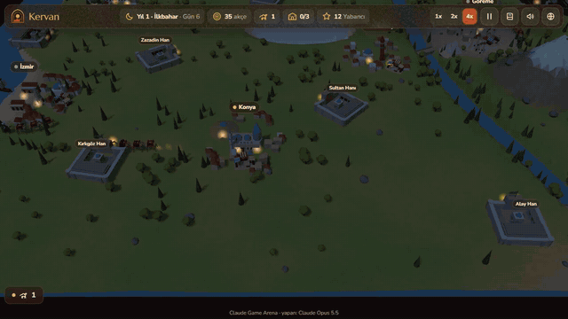
  <br>
  <sub>Watch the promo: <a href="https://github.com/Furkiozknn/social-videos/releases/download/promo-2026-10/2026-10-27-kervan-en.mp4">EN</a> · <a href="https://github.com/Furkiozknn/social-videos/releases/download/promo-2026-10/2026-10-27-kervan-tr.mp4">TR</a></sub>
</p>

<p align="center"><b>Play online: <a href="https://furkiozknn.github.io/kervan/">https://furkiozknn.github.io/kervan/</a></b> (desktop and phone, no install)</p>

## Highlights

- **Seven cities, one living market.** Bursa, Izmir, Konya, Aksaray, Göreme, Kayseri and Urfa each produce some goods
  cheaply and want others; prices drift, react to what you and three rival merchants sell, and recover slowly.
- **Caravans that follow the roads.** Pick a caravan, click a city, and it travels there with the route and ETA shown;
  it can be redirected while on the road and stops at a caravanserai or camps at night.
- **Bandits, guards and caravanserais.** Bandits camp on roads you neglect; guards and restored caravanserais keep them
  away, and upgraded caravanserais cut camel upkeep, earn every day and charge rivals for the night.
- **Seasons, contracts and events.** Snow closes the Kayseri–Urfa pass in winter, spring floods slow river crossings,
  plague and festivals shift demand, and cities offer delivery contracts that raise your reputation.
- **Balanced by a bot.** The `?auto` bot plays with the same actions as a player and won 12 of 12 seeded runs between
  day 158 and day 211; a careless bot that buys camels and random goods went bankrupt in the first season every time.
- **Light on a laptop GPU.** About 60 fps (the vsync cap) on Intel UHD 620 at 1280x720 with 20-29 draw calls, and a
  `?low` tier for phones ([measurements](docs/assets.md)).
- **One file, made in code.** One `index.html` with Three.js r170 from a CDN; models, music and sound are procedural,
  with an optional CC0 asset pass loaded on top.

## How to play

> [!TIP]
> **Goal:** 10,000 akçe in cash **and** 3 caravanserais of your own before the end of year 5. A faster win earns more
> stars and a higher score; afterwards you can keep playing in endless mode.

You start in Konya with one caravan (a merchant on horseback and 3 camels) and 200 akçe. Select a caravan, then click a
city to send it there. Click a city to open its market: on a good's slider, left sells and right buys, and the preview
shows the total, the average price and how far your trade moves the price.

<details>
<summary><b>More rules</b></summary>

- Every city produces some goods (cheap, deep stock) and wants others (dear, thin stock). Prices drift, react to what
  you and the three rival merchants sell, and recover slowly, so spread your trade over several routes.
- Camels carry 10 units each and cost upkeep every day. Guards cost upkeep too, but bandits camp on roads you neglect.
- Caravans travel by day. At night they stop at the caravanserai on their road if it is close, otherwise they camp.
- Caravanserais (one on every long road) can be restored and upgraded: they keep bandits away, cut camel upkeep on all
  your caravans, earn a little every day and charge rival caravans for the night.
- Reputation with each city grows with trade and contracts and narrows the buy/sell spread. Cities offer contracts
  such as "deliver 20 carpets to Izmir before the first snow".
- Seasons matter: snow closes the mountain pass between Kayseri and Urfa in winter, spring floods slow the river
  crossings. Plague and festivals change a city's demand for a while.
- If your cash stays below zero and nothing is left to sell, you go bankrupt.

</details>

### Controls

| Action | Mouse / touch | Keyboard |
|---|---|---|
| Select caravan | click the rider or a caravan button | `C` cycles caravans |
| Send / open market | click a city (or its label) | Tab to a label, `Enter` |
| Pan | drag | arrows / `WASD` |
| Zoom | wheel / pinch | `+` / `-` |
| Speed | 1x 2x 4x buttons | `1` `2` `3` |
| Pause menu | pause button | `P` / `Esc` (Esc first closes panels) |
| Music / effects / language | settings | `M` / `X` / `L` |
| Fullscreen | settings | `F11` |

Settings (master, music and effects volume, TR / EN, Low / High quality, fullscreen) are saved in `localStorage`
under `arena.kervan.settings`; the run under `arena.kervan.save`, the best score under `arena.kervan.best`.
Turkish is the default language.

<details>
<summary><b>URL flags for testing</b></summary>

| Flag | Effect |
|---|---|
| `?auto` | the game plays itself with a bot that uses the same actions as a player (4x speed, `&speed=N` to change) |
| `?debug` | fps, draw calls, CPU timings and JS errors on screen; `window.kervanSim(seconds)` fast-forwards without rendering |
| `?sim=N` | fast-forward N seconds (at 1x) before the first frame |
| `?low` | no shadows, pixel ratio 1, half the particles and trees |
| `?lang=en` / `?lang=tr` | language |
| `?seed=N` | fixed world seed |
| `?nosave` | do not write the run to `localStorage` |
| `?noassets` | skip the optional models, textures, HDRI and sound files (fully procedural) |

The live state is on `window.kervan` (`kervan.state`, `kervan.sim`, `kervan.info()`).

</details>

## Screenshots

<table>
  <tr>
    <td width="33%">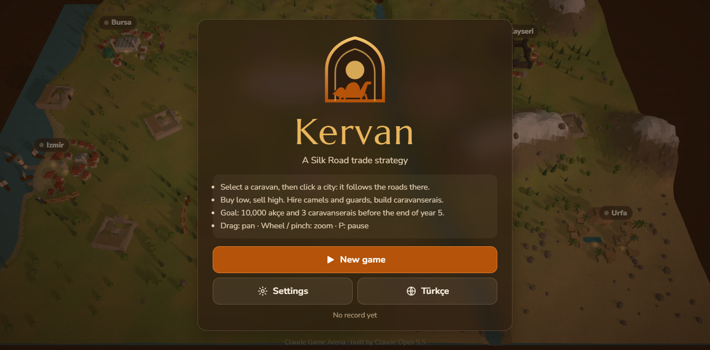<br><sub>Title screen</sub></td>
    <td width="33%">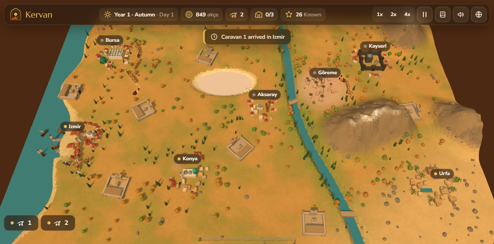<br><sub>Seven cities on one map</sub></td>
    <td width="33%">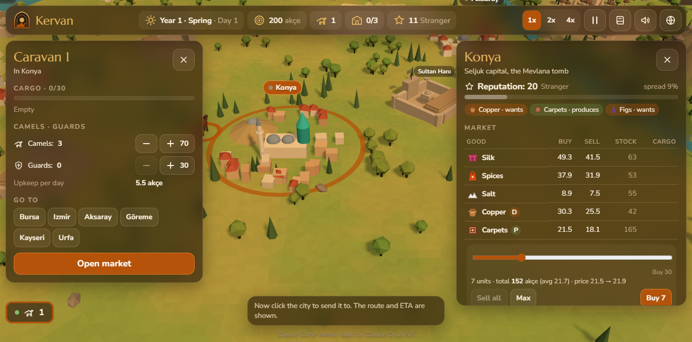<br><sub>Caravan panel and the Konya market</sub></td>
  </tr>
  <tr>
    <td>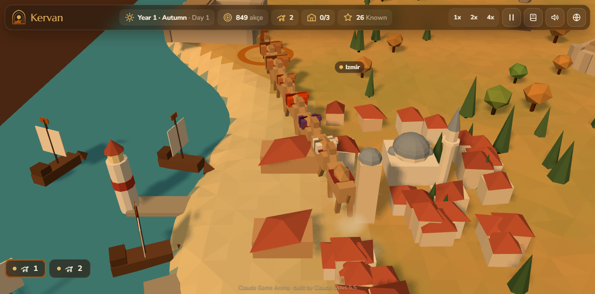<br><sub>Izmir harbour</sub></td>
    <td>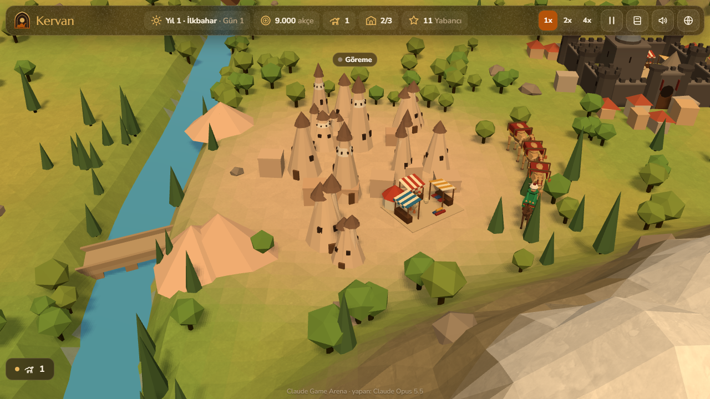<br><sub>Fairy chimneys of Göreme</sub></td>
    <td>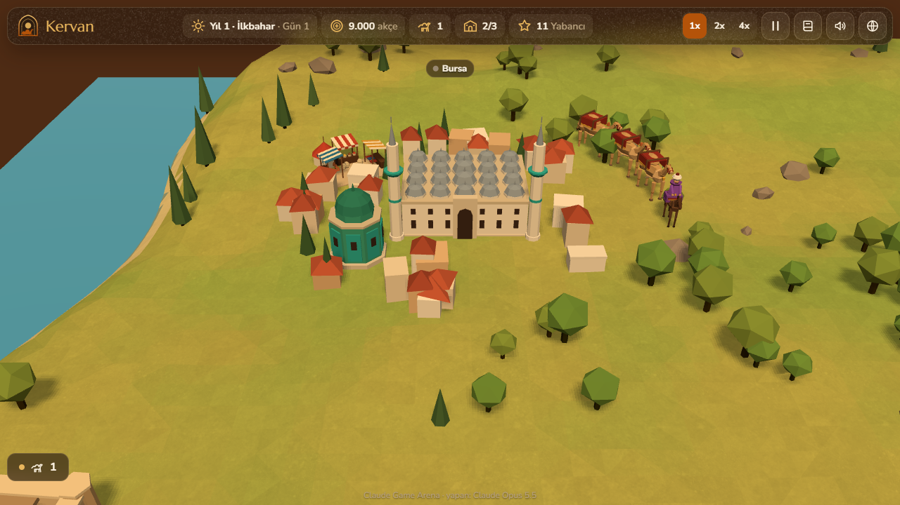<br><sub>Bursa and its Ulu Cami</sub></td>
  </tr>
  <tr>
    <td>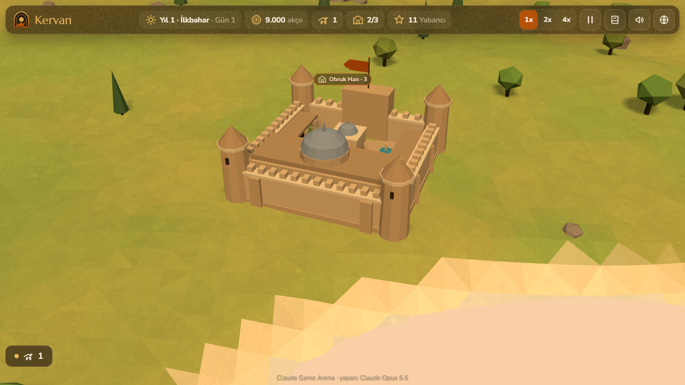<br><sub>A restored caravanserai</sub></td>
    <td>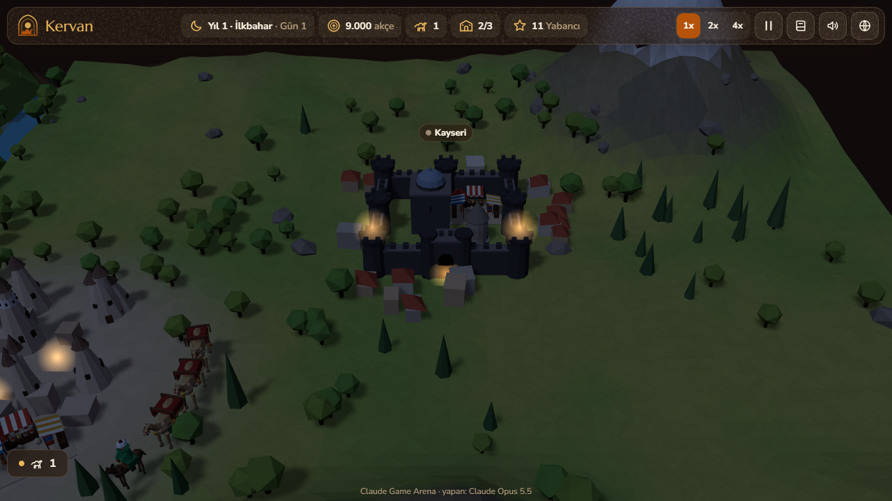<br><sub>Night at Kayseri</sub></td>
    <td>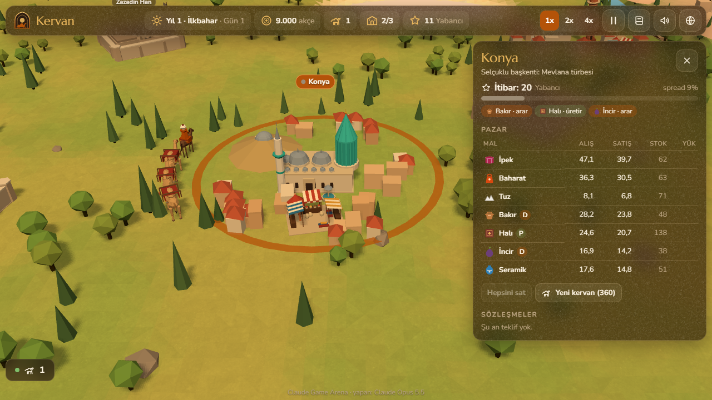<br><sub>Konya market (Turkish UI)</sub></td>
  </tr>
</table>

<details>
<summary><b>Phone layout and the asset pass, before and after</b></summary>

<table>
  <tr>
    <td width="50%">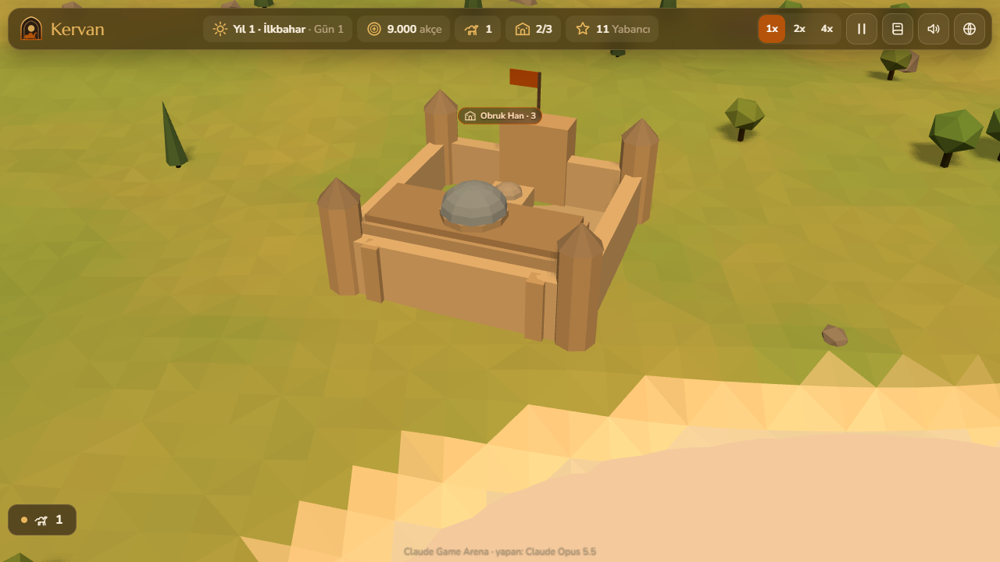<br><sub>Caravanserai, procedural</sub></td>
    <td width="50%"><br><sub>Caravanserai, with the asset pass</sub></td>
  </tr>
  <tr>
    <td>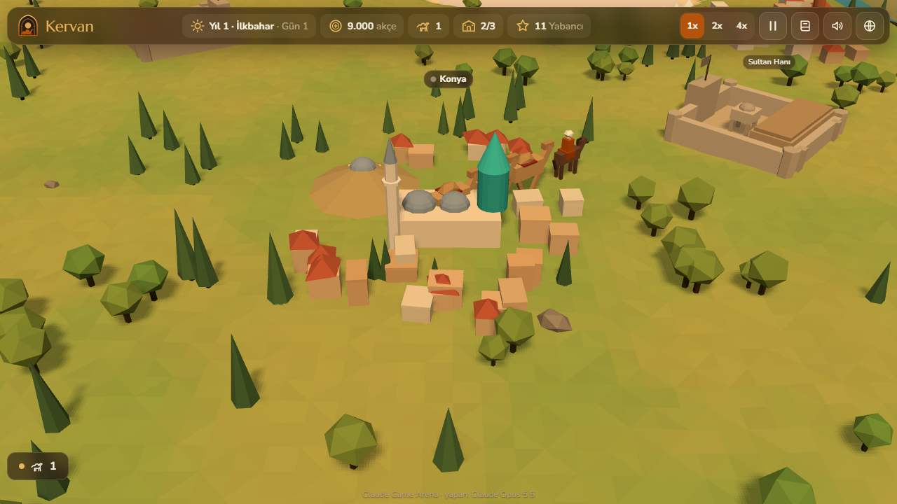<br><sub>Konya, procedural</sub></td>
    <td>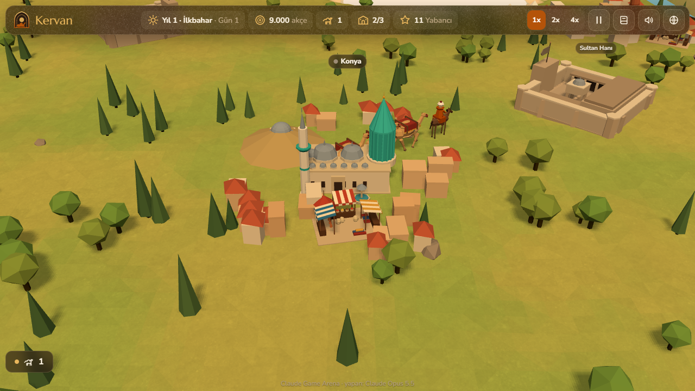<br><sub>Konya, with the asset pass</sub></td>
  </tr>
</table>

<p align="center">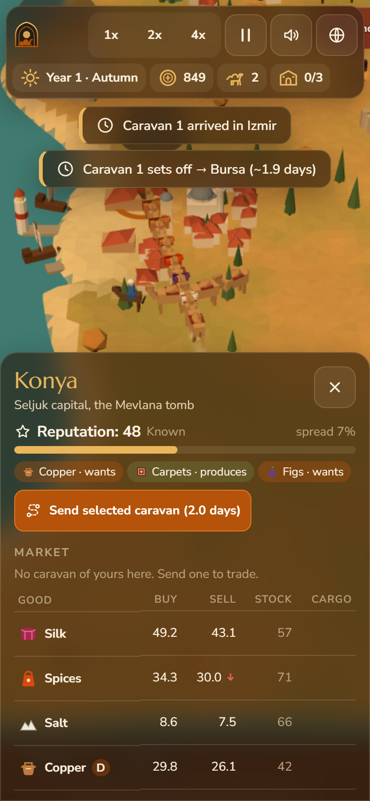<br><sub>On a phone</sub></p>

</details>

## Balance

All prices, goods, costs, caravanserai levels, contracts and events live in one table, `ECONOMY`, at the top of the
simulation script. The simulation core does not depend on the renderer, so the same rules run headless in Node:
the `?auto` bot won 12 of 12 seeded runs between day 158 and day 211 (years 2 and 3), while a careless bot that buys
camels and random goods went bankrupt within the first season in every run.

## Running locally

Serve the folder over HTTP (ES modules do not load from `file://`):

```
python -m http.server 8000
```

then open <http://localhost:8000/>.

## How it was made

Built by **Claude Opus 5.5** with Claude Code from one prompt: [prompts/kervan.md](prompts/kervan.md). The base game is
fully procedural: the terrain, cities, caravanserais, caravans and bandits are merged or instanced low-poly primitives
with vertex colours, and the ney-and-frame-drum music, camel bells, footsteps, bazaar murmur and wind are synthesised
with the Web Audio API.

An optional asset pass adds Blender-built low-poly models (camels with a nodding head, the caravan leader and guards,
caravanserais, a bazaar corner and landmarks for each of the seven cities), a subtle terrain detail texture, a
parchment grain on the panels, a Poly Haven HDRI for the water on the High tier and CC0 sounds. They load after the
first frame and the procedural versions stay as the fallback (`?noassets` skips them; the Low tier keeps the
procedural models). Licences: [CREDITS.md](CREDITS.md); file list, sizes and fps before and after:
[docs/assets.md](docs/assets.md). Model scripts: `assets/src/`.

Kervan is part of the **Claude Game Arena** series, where each game is built by a Claude model from one prompt. The
other games: [Hisar](https://furkiozknn.github.io/kale-savunmasi/) ·
[Çay Ocağı](https://furkiozknn.github.io/cay-ocagi/) · [Çini Ustası](https://furkiozknn.github.io/cini-ustasi/) ·
[Martı](https://furkiozknn.github.io/marti/) · [Dolmuş](https://furkiozknn.github.io/dolmus/) ·
[Peri Golf](https://furkiozknn.github.io/peri-golf/) · [Mehter](https://furkiozknn.github.io/mehter/) ·
[Boğaz Vapuru](https://furkiozknn.github.io/bogaz-vapuru/) · [Simit Fırını](https://furkiozknn.github.io/simit-firini/)
· [Karagöz](https://furkiozknn.github.io/karagoz/) · [Lale Bahçesi](https://furkiozknn.github.io/lale-bahcesi/)

**Round 5:** [Kapadokya Balonu](https://furkiozknn.github.io/kapadokya-balonu/) ·
[Ebru](https://furkiozknn.github.io/ebru/) · [Kırkpınar](https://furkiozknn.github.io/kirkpinar/) ·
[Çarşı Kaçışı](https://furkiozknn.github.io/carsi-kacisi/)

## Türkçe

**Kervan**, altın saatte alçak poligon bir Anadolu haritasında geçen 3D İpek Yolu ticaret oyunu. Deve kervanlarını yedi
şehir arasında yönet, ucuza al pahalıya sat, haydutlara karşı muhafız tut ve 5. yıl bitmeden 10.000 akçe ile 3
kervansaraya ulaş. Kurulum yok; masaüstünde ve telefonda tarayıcıda oynanır. Claude Opus 5.5 tarafından Claude Code ile
tek bir prompt'tan yapıldı.

**Oyna:** https://furkiozknn.github.io/kervan/

## License

MIT, see [LICENSE](LICENSE). Third-party assets are CC0, see [CREDITS.md](CREDITS.md).
